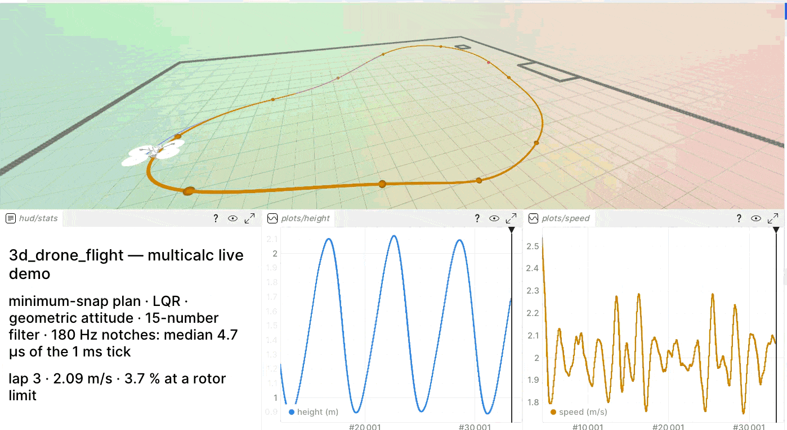
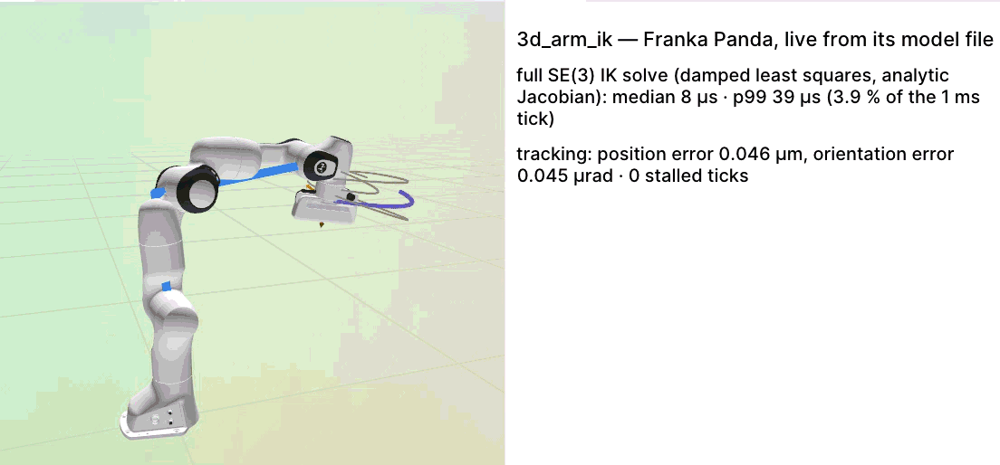

# multicalc

[](https://kmolan.github.io/multicalc-rust/)
[](https://crates.io/crates/multicalc)

[](https://github.com/kmolan/multicalc-rust/actions/workflows/ci.yml)
[](https://docs.rs/multicalc)
[](LICENSE)

**Robotics for microcontrollers.** Sense, plan, estimate and control in `no_std` Rust in one
integrated package. Tested on real hardware: run the same code from your laptop to a Cortex-M4.

<p>
  
  
</p>

*The [live showcases](demos#live-showcases). Each number on screen is measured live, inside a 1 ms
tick.*

## Highlights

- **1 kHz control loops.** Fixed-size types, no heap, and bounded work for each call.
- **Tested on real silicon.** Pinocchio-exact robot dynamics, checked on each run, and a full
  1 kHz arm control loop on a 100 MHz Cortex-M4F. CI also tests the `x86_64` and `aarch64` hosts
  and four bare-metal targets under QEMU.
- **Checked against reference libraries.** 183 checks against NumPy, SciPy, MuJoCo, Pinocchio,
  mpmath and FilterPy. See the [benchmarks](benchmarks).
- **Heap only on request.** The default build needs no allocator. The `alloc` feature adds the particle
  filter, Monte Carlo localization and `DynamicOccupancyGrid`.
- **Safe and panic-free.** `#![forbid(unsafe_code)]`, no C dependencies, and a typed error from each
  fallible call.
- **Builds in seconds.** A clean build of the whole crate takes about 2.5 s, debug, release or
  `thumbv7em`, with one dependency, `libm`. Generic code compiles in your crate, only for the
  scalar types that you use. (i7-12650H, Rust 1.100.)

## Quick start

### A robot arm

```sh
cargo add multicalc multicalc-robot-model
```

The model file is from [MuJoCo Menagerie](https://github.com/google-deepmind/mujoco_menagerie).

```rust,no_run
use multicalc::{ComputedTorqueController, JointReference, Vector};
use multicalc_robot_model::load_path;

fn main() -> Result<(), Box<dyn std::error::Error>> {
    // The Franka Panda from MuJoCo Menagerie: a welded base, seven hinges, a welded hand.
    let model = load_path("mujoco_menagerie/franka_emika_panda/panda.xml".as_ref())?;
    let gravity = Vector::new([0.0, 0.0, -9.81]);
    let arm = model.articulated_body_to::<9, 9>("hand", gravity)?;

    // G(q) at the home pose, by RNEA. Slots 0 and 8 are the welds.
    let home = Vector::new([0.0, 0.0, 0.0, 0.0, -1.5708, 0.0, 1.5708, -0.7854, 0.0]);
    let holding = arm.gravity_torque_at(&home)?;

    // One control tick: computed torque from the measured state toward the home pose.
    let controller = ComputedTorqueController::from_natural_frequency(20.0, 1.0)?;
    let measured_position = Vector::new([0.0, 0.1, 0.0, 0.0, -1.5, 0.0, 1.6, -0.7854, 0.0]);
    let measured_velocity = Vector::zeros();
    let reference = JointReference::at_rest(home);
    let torque = controller.torque_at(&arm, &measured_position, &measured_velocity, &reference)?;

    Ok(())
}
```

On a microcontroller, `RobotModel::to_rust_source` writes the model as one Rust function, and
the firmware compiles it. See [ARCHITECTURE.md](ARCHITECTURE.md#crates).

### Exact derivatives

```rust
use multicalc::prelude::*;
use multicalc::{KalmanFilter, KalmanModel, Matrix, Newton, SE3, SO3, Vector, constant, scalar_fn};

fn main() -> Result<(), CalcError> {
    // One formula: evaluated at f64, and at a dual number for exact derivatives.
    let f = scalar_fn!(|x| x * x * x - constant(2.0) * x);   // x³ − 2x

    let slope = derivative(&f, 2.0);                          // 10, exact
    let root = Newton::new().solve(&f, 2.0)?.root;            // √2
    let area = integral(&|x: f64| f.eval(x), [0.0, 2.0])?;    // 0

    // A quarter turn about z, then a translation.
    let rotation = SO3::exp(Vector::new([0.0, 0.0, core::f64::consts::FRAC_PI_2]));
    let pose = SE3::from_parts(rotation, Vector::new([1.0, 2.0, 3.0]));
    let moved = pose.act(Vector::new([1.0, 0.0, 0.0]));      // (1, 3, 3)

    // A Kalman filter recovers a velocity that it does not measure.
    let model = KalmanModel {
        state_transition: Matrix::new([[1.0, 1.0], [0.0, 1.0]]),
        measurement_model: Matrix::new([[1.0, 0.0]]),
        process_noise: Matrix::new([[0.01, 0.0], [0.0, 0.01]]),
        measurement_noise: Matrix::new([[0.1]]),
    };
    let mut filter = KalmanFilter::new(Vector::new([0.0, 0.0]), Matrix::new([[1.0, 0.0], [0.0, 1.0]]), model);
    filter.predict();
    filter.update(Vector::new([1.0]))?;
    let velocity = filter.state()[1];

    Ok(())
}
```

Each module has its own error enum, and each one converts into `CalcError`.

## What it does

### Robotics

| Module | Contents |
| --- | --- |
| [Estimation](crates/multicalc/tutorials/estimation.md) | Linear, extended and unscented `KalmanFilter`, `ErrorStateKalmanFilter`, `MahonyFilter`, `MadgwickFilter`; `ParticleFilter` and `MonteCarloLocalizer` (`alloc`) |
| [Control](crates/multicalc/tutorials/control.md) | `Pid`, `Lqr`, `GeometricAttitudeController`, pure pursuit, `FollowTheGap`, `ComputedTorqueController`, joint and Cartesian impedance, `JointPdController` |
| [Spatial math](crates/multicalc/tutorials/spatial-quaternions-and-lie-groups.md) | `Quaternion`, `SO2`/`SE2`/`SO3`/`SE3` with Jacobians, `Twist`, `Wrench`, `SpatialInertia` |
| [Rigid-body dynamics](crates/multicalc/tutorials/rigid-body-dynamics.md) | `RigidBody`, `ArticulatedBody`: RNEA, CRBA, ABA, momentum observer. Models from MJCF or URDF |
| [Kinematics](crates/multicalc/tutorials/kinematics.md) | `KinematicTree`, forward and inverse kinematics, `CollisionQuery` |
| [Plant](crates/multicalc/tutorials/plant.md) | `MultirotorMixer`, `RotorLag`, `PositionServo` |
| [Motion](crates/multicalc/tutorials/motion.md) | `PolylinePath`, `MinimumSnapPlanner`, `MotionProfilePlanner` |
| [Mapping](crates/multicalc/tutorials/mapping.md) | `OccupancyGrid`, `DynamicOccupancyGrid` (`alloc`), `LogOddsGrid`, `DistanceField`, `CostGrid` |
| [Planning](crates/multicalc/tutorials/planning.md) | `GridPlanner` (Dijkstra, A\*, Theta\*), `Rrt`, `RrtStar`, `Prm`. Caller-owned workspaces, no allocation |
| [MLP inference](crates/multicalc/tutorials/mlp-inference.md) | `Layer`, `Activation`, `ParameterCursor` for trained policies |

### The core, also usable alone

Built on its own `no_std` math core: autodiff, linear algebra and solvers.

| Module | Contents |
| --- | --- |
| [Autodiff](crates/multicalc/tutorials/scalars-and-automatic-differentiation.md) | Exact derivatives (to order 6 in one variable, 3 in several), `Jacobian`, `Hessian` |
| [Linear algebra](crates/multicalc/tutorials/linear-algebra.md) | `Matrix`, `Vector`: LU, Cholesky, QR, SVD, eigendecomposition, `expm`, Riccati and Lyapunov solvers |
| [Least squares](crates/multicalc/tutorials/least-squares-optimization.md) | `LevenbergMarquardt`, `GaussNewton` |
| [Root finding](crates/multicalc/tutorials/root-finding.md) | Bisection, Brent, Newton, damped line search |
| [Polynomials](crates/multicalc/tutorials/polynomials.md) | `Polynomial`, `PiecewisePolynomial`, `MultivariatePolynomial` |
| [Integration](crates/multicalc/tutorials/integration.md) | Newton-Cotes, Gauss-Legendre, Gauss-Hermite, Gauss-Laguerre |
| [ODE](crates/multicalc/tutorials/ode-integrators.md) | `Rk4`, `Rk45`, `ExponentialMap` |
| [Discretization](crates/multicalc/tutorials/discretization.md) | Zero-order hold, Van Loan, discrete white noise |
| [Signal processing](crates/multicalc/tutorials/signal-processing.md) | `Biquad`, `MovingAverage`, `RunningMedian`, `SavitzkyGolay`, `SlewRateLimiter` |
| [Vector calculus](crates/multicalc/tutorials/vector-calculus.md) | Curl, divergence, line and flux integrals |
| [Approximation](crates/multicalc/tutorials/taylor-approximation.md) | Linear and quadratic Taylor models |
| [Random](crates/multicalc/tutorials/random.md) | `Pcg32`, `RandomSource` |

## MuJoCo Menagerie

`multicalc-robot-model` reads MJCF and URDF. Of the 71 robots in
[MuJoCo Menagerie](https://github.com/google-deepmind/mujoco_menagerie) (commit `eea4c74`,
2026-11-23), 40 load. CI checks three of them against the MuJoCo compile of the same file; see
[`benchmarks/mjcf.md`](benchmarks/mjcf.md). RNEA, CRBA and ABA need a fixed base; a floating-base
model gives kinematics only.

The reader takes `asset`, `compiler`, `default` and `worldbody`. `RobotModel::ignored()` lists
each other top-level section: `actuator`, `contact`, `custom`, `equality`, `keyframe`, `option`,
`sensor`, `size`, `statistic`, `tendon`, `visual`. A coupling in `equality` or `tendon` does not
reach the tree. The reader refuses, by name, what it cannot represent exactly: mass from a mesh
geom, a ball joint, and several joints on one body.

<details>
<summary>Each Menagerie robot</summary>

| Robot | Status | Base |
| --- | --- | --- |
| `agilex_piper` | Refused: a geom `size` the reader cannot parse | — |
| `agility_cassie` | Refused: a ball joint | — |
| `aloha` | Loads | fixed |
| `anybotics_anymal_b` | Loads | floating |
| `anybotics_anymal_c` | Loads | floating |
| `apptronik_apollo` | Refused: a body with no `<inertial>` and no geom | — |
| `arx_l5` | Refused: mass from a mesh geom | — |
| `berkeley_humanoid` | Loads | floating |
| `bitcraze_crazyflie_2` | Loads | floating |
| `booster_t1` | Loads | floating |
| `boston_dynamics_spot` | Loads | floating |
| `dynamixel_2r` | Loads | fixed |
| `fanuc_crx5ia` | Loads | fixed |
| `flexiv_rizon4` | Refused: mass from a mesh geom | — |
| `flexiv_rizon4s` | Refused: mass from a mesh geom | — |
| `flybody` | Refused: mass from a mesh geom | — |
| `fourier_n1` | Loads | floating |
| `franka_emika_panda` | Checked against MuJoCo in CI, except `panda_nohand.xml` (a body with no `<inertial>` and no geom) | fixed |
| `franka_fr3` | Refused: a body with no `<inertial>` and no geom | — |
| `franka_fr3_duo` | Refused: a body with no `<inertial>` and no geom | — |
| `franka_fr3_v2` | Refused: a body with no `<inertial>` and no geom | — |
| `google_barkour_v0` | Loads | floating |
| `google_barkour_vb` | Refused: a body with no `<inertial>` and no geom | — |
| `google_robot` | Refused: mass from a mesh geom | — |
| `hello_robot_stretch` | Refused: mass from a mesh geom | — |
| `hello_robot_stretch_3` | Refused: mass from a mesh geom | — |
| `i2rt_yam` | Refused: mass from a mesh geom | — |
| `iit_softfoot` | Refused: several joints on one body | — |
| `kinova_gen3` | Loads | fixed |
| `kuka_iiwa_14` | Loads | fixed |
| `leap_hand` | Loads | fixed |
| `low_cost_robot_arm` | Refused: mass from a mesh geom | — |
| `ms_human_700` | Refused: several joints on one body | — |
| `pal_talos` | Loads | floating |
| `pal_tiago` | Loads, except `tiago_position.xml` (a geom `size` the reader cannot parse) | floating |
| `pal_tiago_dual` | Refused: a geom `size` the reader cannot parse | — |
| `pndbotics_adam_lite` | Loads | floating |
| `rainbow_robotics_rby1` | Refused: a geom `size` the reader cannot parse | — |
| `realsense_d435i` | Refused: mass from a mesh geom | — |
| `rethink_robotics_sawyer` | Loads | fixed |
| `robot_soccer_kit` | Loads | floating |
| `robotiq_2f85` | Refused: mass from a mesh geom | — |
| `robotiq_2f85_v4` | Loads, except `mjx_2f85.xml` (a geom `size` the reader cannot parse) | fixed |
| `robotis_omy_3m` | Loads | fixed |
| `robotis_op3` | Loads | floating |
| `robotstudio_so101` | Refused: mass from a mesh geom | — |
| `seeed_rebot_devarm` | Loads | fixed |
| `shadow_dexee` | Refused: mass from a mesh geom | — |
| `shadow_hand` | Loads | fixed |
| `sharpa_wave` | Refused: mass from a mesh geom | — |
| `skydio_x2` | Checked against MuJoCo in CI | floating |
| `stanford_tidybot` | Refused: several joints on one body | — |
| `tetheria_aero_hand_open` | Refused: mass from a mesh geom | — |
| `toddlerbot_2xc` | Loads | floating |
| `toddlerbot_2xm` | Loads | floating |
| `trossen_vx300s` | Loads | fixed |
| `trossen_wx250s` | Loads | fixed |
| `trossen_wxai` | Loads | fixed |
| `trs_so_arm100` | Refused: mass from a mesh geom | — |
| `ufactory_lite6` | Refused: a non-positive inertia | — |
| `ufactory_xarm7` | Loads | fixed |
| `umi_gripper` | Refused: several joints on one body | — |
| `unitree_a1` | Loads | floating |
| `unitree_g1` | Loads | floating |
| `unitree_go1` | Checked against MuJoCo in CI | floating |
| `unitree_go2` | Loads, except `go2_mjx.xml` (a geom `size` the reader cannot parse) | floating |
| `unitree_h1` | Loads | floating |
| `unitree_z1` | Loads | fixed |
| `universal_robots_ur10e` | Loads | fixed |
| `universal_robots_ur5e` | Loads | fixed |
| `wonik_allegro` | Refused: mass from a mesh geom | — |

</details>

## Benchmarks

**On the host, in `f64`, against reference libraries.** RNEA, CRBA and ABA of the Menagerie Franka
Panda agree with Pinocchio 4.1.0 to `1e-10` over 128 random states. Forward kinematics, Jacobians
and model reading agree with MuJoCo 3.11.0 to `1e-11`.

**On silicon, with each answer checked on each run.** Nucleo-F411RE, Cortex-M4F at 100 MHz, `f32`
on the FPU:

| Check | Time |
| --- | ---: |
| Franka Panda control tick: computed torque and momentum observer | 0.70 ms |
| Skydio X2 attitude control and mixer | 16 µs |
| Skydio X2 control tick: ESKF, LQR, thrust, attitude, mixer | 1.86 ms |
| MLP policy, 22→64→64→4 | 0.53 ms |

On all three boards, RNEA, CRBA and ABA of the Franka agree with Pinocchio to `1e-10` in `f64`. The
Cortex-M FPUs are single precision, so the `f64` rows show accuracy, not speed. One `Dual` RNEA pass
gives the exact column `∂τ/∂q̈` on each board. On the Nucleo, the worst of seven runs of the arm
tick is within 0.1% of the best. [`silicon.md`](benchmarks/silicon.md) has each check on the Nucleo,
a Cortex-M33 and an RV32IMC.

Each module has its own accuracy table in [`benchmarks`](benchmarks).

## Documentation

- **[Website](https://kmolan.github.io/multicalc-rust/)**: demos, silicon timings, latency and accuracy charts.
- **[Tutorials](crates/multicalc/tutorials/README.md)**: one page for each module.
- **[API docs](https://docs.rs/multicalc)**: the full API reference.
- **[Demos](demos)**: a self-checking example for each module, and seven live showcases. Run one with
  `cargo run -p multicalc-demos --example <name>`.
- **[Benchmarks](benchmarks)**: accuracy tables for each module, and latency.

## Repository layout

| Path | Contents |
| --- | --- |
| [`crates/multicalc`](crates/multicalc) | The library |
| [`crates/multicalc-robot-model`](crates/multicalc-robot-model) | MJCF and URDF reader, and a `model_viewer` |
| [`demos`](demos) | Examples and live showcases |
| [`tools/qa`](tools/qa) | Accuracy fixtures and the benchmark tables |
| [`tools/embedded-smoke`](tools/embedded-smoke) | Bare-metal tests under QEMU |
| [`tools/hilshare`](tools/hilshare) | Tests on real boards |
| [`site`](site) | The website |
| [`ARCHITECTURE.md`](ARCHITECTURE.md) | The crates, the domains, and the layer graph |

## Contributing

Contributions are welcome. See [CONTRIBUTING.md](CONTRIBUTING.md).

## Acknowledgements

The least-squares solvers and QR factorization port the public-domain MINPACK routines (Moré,
Garbow, Hillstrom; netlib); the full citation is in the
[crate README](crates/multicalc/README.md#acknowledgements).

## License

Licensed under the [MIT License](LICENSE).

## Contact

anmolkathail@gmail.com
