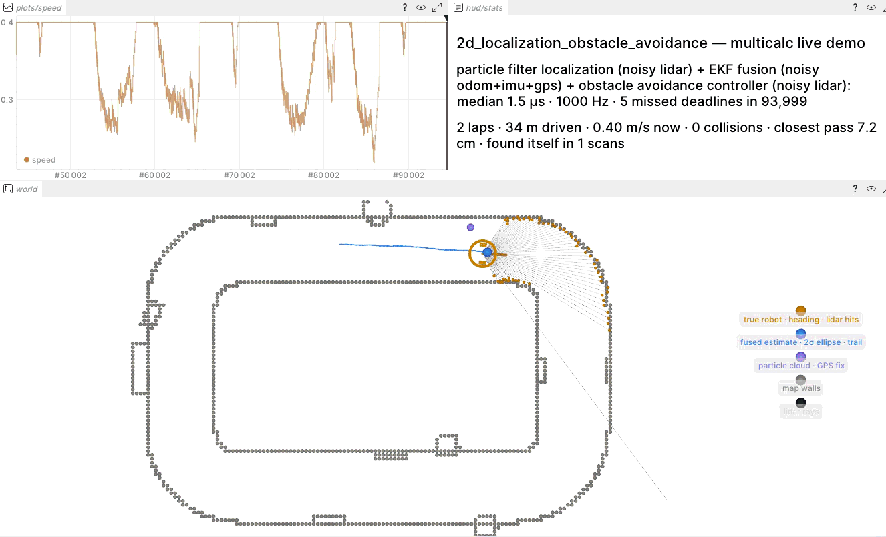
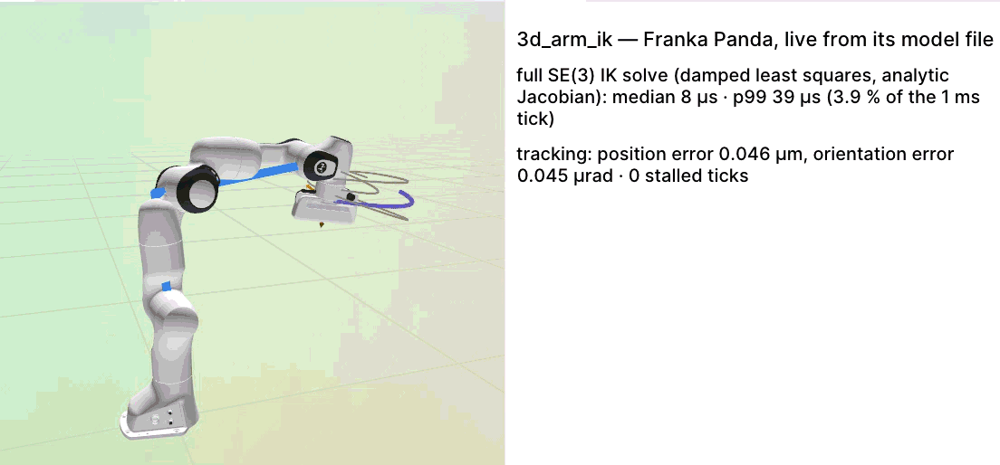
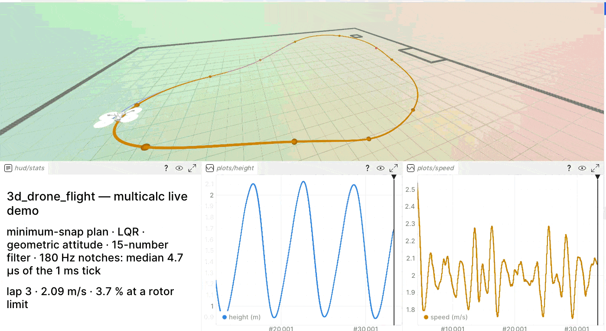
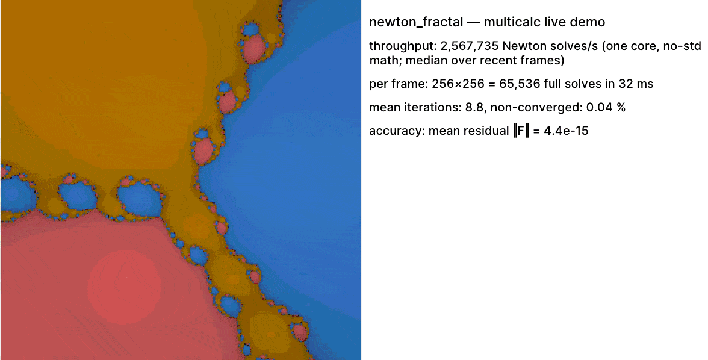
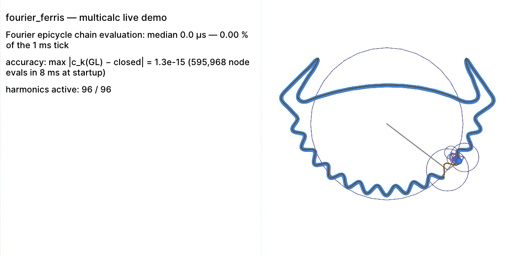
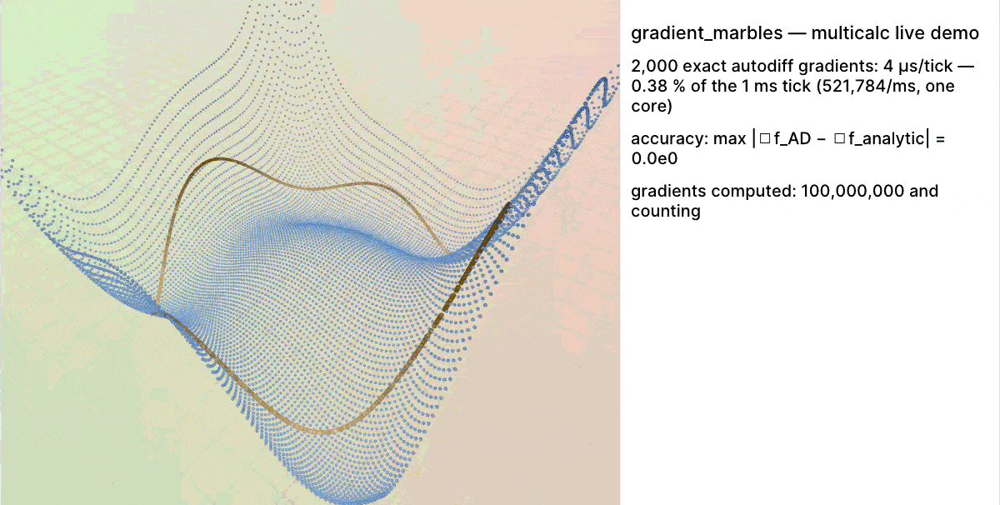

# multicalc-demos

Runnable demos for [`multicalc`](../crates/multicalc):

- Seven live [Rerun](https://rerun.io) **[showcases](#live-showcases)** that animate a scene and
  stream measured speed and accuracy.
- Thirty-three headless **[basics](#basics)**, about one for each module, each checked against
  the analytic value.

This is a satellite crate. The core library never depends on it. It is excluded from bare-metal
builds, from the default `cargo test`, and from the `cargo deny` supply-chain audit.

## Live showcases

```sh
cargo run --release -p multicalc-demos --example <name>
```

A showcase needs the `rerun` feature (on by default) and a [version-matched viewer](#viewer-setup).
Build with `--release` for representative time readouts.

- **Each number on screen is measured live** with `std::time::Instant` in the demo. No number is
  hardcoded.
- Each demo advances on logical time (a fixed 1 ms per tick, or one step per frame), so the
  results are reproducible. A scheduling spike can delay the display of a tick, but it does not
  change what the demo computes.

The figures below are for a modern desktop core (`x86_64`, `--release`).

- **`2d_localization_obstacle_avoidance`** (estimation + control). A differential-drive robot finds
  itself with a 2,000-particle filter on a known map, holds the pose with a 5-state EKF, and laps an
  obstacle course on Follow-the-Gap. **0.72 µs/tick, zero collisions over 600,000 ticks.**

  

- **`3d_arm_ik`** (spatial, kinematics, dynamics, control). A Franka Panda sweeps its reach shell on
  1 kHz SE(3) IK, a gravity-compensated joint PD driving its dynamics. **Lag 2–6 mm**, 40 µs/tick.

  

- **`3d_arm_torque`** (motion, kinematics, control, dynamics). A Franka Panda tracks a jerk-limited
  waypoint cycle on 1 kHz computed torque, with a 2 kg payload that its model lacks and
  near-constant pushes from random directions at the hand. A momentum observer estimates the
  disturbance from `q`, `q̇` and `τ` alone, and `τ = τ_computed − r` holds the hand on its path.
  **Hand within 2.2 mm of the path (28 mm without the observer)**, 2 µs/tick.

- **`3d_drone_flight`** (dynamics + control + estimation). A Skydio X2, mass from its MuJoCo file,
  finds its heading against a floor plan, then flies a minimum-snap loop on a 15-state error-state
  filter, an LQR and a geometric attitude loop. **≈ 2 µs/tick.**

  

- **`newton_fractal`** (root finding). Every pixel is a full Newton-system solve with an exact
  autodiff Jacobian, and the cubic's basins swirl as its roots orbit. **≈ 4 million Newton
  solves/sec on one core** (a 256×256 grid re-solved at ~60 fps), each converged root accurate to
  **≈ 5e-15**.

  

- **`fourier_ferris`** (integration). Gauss-Legendre quadrature computes the Fourier coefficients
  of Ferris's outline; a chain of epicycles then draws the crab. **≈ 600,000 quadrature node
  evaluations in ≈ 8 ms** at startup, with every coefficient matching the exact closed form to
  **≈ 1e-15**.

  

- **`gradient_marbles`** (autodiff). 2,000 marbles across a 3D Himmelblau landscape, each steered
  by an exact autodiff gradient every millisecond. **2,000 exact gradients in under 3 µs per tick
  (~750,000 gradients/ms), and the autodiff-vs-analytic error is pinned at exactly 0.0** on screen.

  

`curve_fit_live` is one more showcase: a live Levenberg-Marquardt fit, streamed as it converges.

## Viewer setup

### Versions

Rerun SDK `=0.33.1` ⇄ viewer `0.33.1`. The SDK is exact-pinned; the viewer must match.

### Install (for the live showcases)

`RerunSink::live()` spawns the external Rerun viewer on `PATH`. Install the viewer version that matches the SDK:

```
cargo install rerun-cli --locked --version 0.33.1
# or: pip install rerun-sdk==0.33.1
# or: cargo binstall rerun-cli --version 0.33.1
```

### WSL usage (viewer on Windows)

Under WSL, the virtualized GPU often cannot start the viewer. Run the viewer on Windows and
stream to it from WSL over gRPC.

1. Enable mirrored networking so WSL and Windows share `localhost`. In `C:\Users\<you>\.wslconfig`:

   ```ini
   [wsl2]
   networkingMode=mirrored
   ```

   Then from Windows PowerShell run `wsl --shutdown`, reopen WSL, and confirm:

   ```
   wslinfo --networking-mode      # -> mirrored
   ```

2. Install the viewer on Windows if needed, version-matched to the SDK (0.33.1):

   ```
   pip install rerun-sdk==0.33.1      # provides the `rerun` command
   # or download the prebuilt rerun.exe for 0.33.1
   ```

3. Start the viewer on Windows (it listens on port 9876):

   ```
   rerun
   ```

4. From WSL, run a live example. If `WSL_DISTRO_NAME` is set, the example connects to
   `127.0.0.1:9876` and does not spawn a local viewer:

   ```
   cargo run -p multicalc-demos --example curve_fit_live
   ```

   The Windows viewer from step 3 must already run.

If WSL uses NAT networking (the default) instead of mirrored networking, do these steps:

1. Set `RERUN_VIZ_URL` to the Windows host. When `RERUN_VIZ_URL` is set, the example connects to it.
2. Start the viewer bound to `0.0.0.0`.
3. Allow inbound TCP 9876 in Windows Firewall.

```
export RERUN_VIZ_URL="rerun+http://$(ip route show default | awk '{print $3}'):9876/proxy"
cargo run -p multicalc-demos --example curve_fit_live
```

## Basics

Headless, with no viewer, and each runs to completion. Each prints its results against the analytic value
with `|err|`, and asserts them. Most use only `multicalc`. These use more:

- `mjcf_model_ingestion`, `urdf_model_ingestion` and `articulated_dynamics` read model files
  through `multicalc-robot-model`.
- `attitude_filter` and `error_state_estimation` draw sensor noise from `rand_pcg` and `rand_distr`.
- `avoidance` and `localized_lap_check` use the `multicalc_demos::sim` simulator.

```sh
cargo run -p multicalc-demos --example <name>
```

| Example | Module(s) | What it shows |
| --- | --- | --- |
| `approximation` | `approximation` | Taylor linear and quadratic approximants, `predict`, goodness-of-fit metrics. |
| `articulated_dynamics` | `dynamics`, `kinematics` | RNEA and ABA on a two-link pendulum: `G(q)`, `H(q)`, armature, friction, the ID→FD round trip, energy drift; Franka holding torques. |
| `attitude_filter` | `estimation`, `ode::ExponentialMap` | `MahonyFilter` vs `MadgwickFilter` on identical readings: accel/mag init, then gyro bias recovered under tumble. |
| `autodiff_scalars` | `scalar` | `Dual` and `HyperDual` used directly: f, f′, f″ off the result fields, no derivator. |
| `avoidance` | `control::follow_the_gap`, `ode` | Follow-the-Gap on a synthetic lidar scan: gap selection, RK4-integrated commands, walled-in stop. |
| `control_loops` | `control`, `motion`, `discretization` | `Pid`, `Lqr` on a cart-pole, `GeometricAttitudeController`, then all three flying waypoints. |
| `curve_fit` | `optimization` | Levenberg-Marquardt fit of `y = a·e^(b·t)` with exact autodiff Jacobians; recovered `a`, `b`, `\|err\|`. |
| `differentiation` | `numerical_derivative` | Autodiff derivatives to order 3: single- and multi-variable, partials, mixed partials. |
| `discretization` | `discretization`, `linear_algebra::expm` | ZOH on a double integrator, Van Loan process noise, `q_discrete_white_noise`, a `Dual` through `expm`. |
| `error_state_estimation` | `estimation` | `ErrorStateKalmanFilter` on an IMU: static init, gyro-only tumble, position and heading aids, bias convergence. |
| `estimation` | `estimation`, `discretization::q_discrete_white_noise` | Linear KF, constant velocity: hand-checked two-step, Joseph vs naive covariance, innovation gating, a `Dual` reproducing the Kalman gain. |
| `forward_kinematics` | `kinematics` | `KinematicTree` FK: two-link arm vs closed form, shifted reference configuration, a branched chain, a `Dual` through the solve. |
| `gaussian_integration` | `numerical_integration::gaussian_integration` | Gauss-Legendre, Gauss-Hermite and Gauss-Laguerre; bare-integrand convention. |
| `iterative_integration` | `numerical_integration::iterative_integration` | Boole, Simpson and trapezoid rules, partial integrals, infinite and semi-infinite limits. |
| `jacobian_hessian` | `numerical_derivative::{jacobian, hessian}` | Jacobian of a vector function, Hessian of a scalar function. |
| `kinematics` | `kinematics` | Wheel↔body maps and their round trip, exact SE(2) odometry vs the closed-form arc, a `Dual` through a step. |
| `lie_groups` | `spatial` | SO(3)/SE(3) compose and act, exp/log round trips, geodesic interpolation, a `Dual` through `exp` ∘ `act`. |
| `linear_algebra` | `linear_algebra` | LU, Cholesky, solves and the direct 4×4 inverse; latency and error on well- and ill-conditioned inputs. |
| `localized_lap_check` | `estimation`, `control`, `kinematics` | Acceptance gate for the localization showcase: 600,000 seeded ticks asserting zero contacts and fused RMS under 5 cm. Needs the `alloc` feature. |
| `minimum_snap_trajectory` | `motion` | `MinimumSnapPlanner` planned off the loop, evaluated inside it. |
| `mjcf_model_ingestion` | `spatial`, `multicalc-robot-model` | MJCF load: a free body's mass, COM and rotational inertia, then a robot's body tree, joint travel and settings. |
| `motion_profiles` | `motion` | Trapezoidal vs jerk-limited seven-phase, against their velocity, acceleration and jerk ceilings; three joints synchronized. |
| `path_planning` | `planning`, `mapping`, `motion`, `control` | A\* against Dijkstra and any-angle Theta\* across a maze, a costmap that pushes the route off the walls, a seeded RRT that reproduces itself exactly, and the plan fed on to a smoother, a profile and a path follower. |
| `ode` | `ode` | RK4 and adaptive RK45 on the harmonic oscillator, an acrobot, a quadrotor and an N-body; error and invariant drift. |
| `optimization_solvers` | `optimization` | Gauss-Newton on the linear residual `y = a + b·t`; when GN suffices vs LM. |
| `polynomials` | `polynomial` | Evaluation with derivatives in one pass, real roots, fit from data, multivariate symbolic partials. |
| `rigid_body_dynamics` | `dynamics`, `plant` | Torque-free tumble and free fall against their invariants; rotor mixing, first-order spin-up, saturation. |
| `root_finding` | `root_finding` | Bisection, Newton with exact derivatives, backtracking Newton from a far start, square-system Newton. |
| `signal_filters` | `signal_processing`, `random` | Notch and low-pass on a seeded noisy signal, plus `RunningMedian` and `SavitzkyGolay`. |
| `svd` | `linear_algebra::svd` | SVD and Moore-Penrose pseudo-inverse: Kabsch, redundant-arm, near-singular Jacobian, overdetermined fit; latency and error. |
| `torque_control` | `control`, `dynamics`, `plant` | Computed torque, joint impedance, gravity-compensated PD and a position servo, each against its defining property. |
| `urdf_model_ingestion` | `spatial`, `multicalc-robot-model` | URDF load: body tree, which links carry inertia, joint axes and travel, the coupled gripper mimic joint. |
| `vector_field` | `vector_field` | Curl, divergence, line integrals, flux integrals. |

`linear_algebra` and `svd` also print per-call latency. Build them with `--release` for
representative numbers. `localized_lap_check` needs the `alloc` feature (on by default) for the
particle filter. Build it with `--release`.
